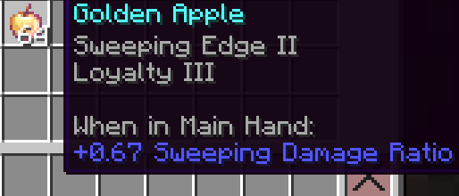

# Enchanted Golden Apple · 附魔金苹果

[](https://www.gnu.org/licenses/lgpl-3.0)
[](https://www.minecraft.net)
[](https://neoforged.net)

A NeoForge mod for **Minecraft 1.21.11** — 一个适用于 **Minecraft 1.21.11** 的 NeoForge 模组。



---

<details open>
<summary>🌐 English</summary>

A NeoForge mod that makes Golden Apples enchantable and turns those enchantments into potion effects when eaten.

## ✨ Features

- 🍎 **Enchantable Golden Apples** — the Golden Apple gains 30 enchantability and accepts *any* enchantment.
- 🧪 **Eat to gain effects** — eating an enchanted Golden Apple grants a potion effect mapped from each enchantment on it.
- ✨ **22 new mob effects** — with custom icons and bilingual (English / 简体中文) names.
- ⚙️ **Simple formula** — effect amplifier = ⌊enchantment level ÷ 2⌋, duration = enchantment level × 10 seconds.

## 🗺️ How it works

1. The Golden Apple is made enchantable (enchantability 30), and mixins let any enchantment be applied to it.
2. When you finish eating an enchanted Golden Apple, the mod reads every enchantment on it.
3. Each enchantment is looked up in `GoldenAppleEffectTable` and converted into a matching mob effect.

## 🗺️ Enchantment → Effect

Effects marked ⭐ are added by this mod.

| Enchantment | Effect |
|---|---|
| Sharpness | Strength |
| Protection / Unbreaking | Resistance |
| Fire Protection | Fire Resistance |
| Feather Falling | Slow Falling |
| Respiration | Water Breathing |
| Depth Strider / Riptide | Dolphin's Grace |
| Efficiency | Haste |
| Fortune | Luck |
| Looting | Hero of the Village |
| Power | Health Boost |
| Mending | Regeneration |
| Smite | Undead Slayer ⭐ |
| Bane of Arthropods | Arthropods Slayer ⭐ |
| Fire Aspect / Flame | Ablaze ⭐ |
| Frost Walker | Frost Touch ⭐ |
| Quick Charge | Combo ⭐ |
| Sweeping Edge | Killing Area ⭐ |
| Soul Speed | Soul Speed ⭐ |
| … | *43 enchantments in total* |

> Full list lives in [`GoldenAppleEffectTable.java`](src/main/java/com/cham/enchantedgoldenapple/GoldenAppleEffectTable.java).

## 📋 Requirements

- **Minecraft** `1.21.11`
- **NeoForge** `21.11.48` or later
- **Java** `21`

## 📦 Installation

1. Download the latest `.jar` from [Releases](../../releases) (or build it yourself).
2. Drop it into your Minecraft `mods` folder.
3. Enchant a Golden Apple, eat it, and enjoy!

## 🔨 Building

Requires JDK 21.

```bash
# Linux / macOS
./gradlew build

# Windows
gradlew.bat build
```

The output jar is in `build/libs/`.

## 📜 License

This project is licensed under the **GNU Lesser General Public License v3.0 (LGPL-3.0)** — © 2026 `cham`. See [LICENSE](LICENSE) for the full text.

> **LGPL in short**: you may freely use, modify and redistribute this mod's code; but if you modify the code itself and redistribute it, you must open-source your changes. Using it as a library linked from closed-source mods is allowed.

## 🙏 Credits

- **Author**: `cham`
- Based on the [NeoForged MDK](https://github.com/NeoForged/MDK) template (template files under their own MIT license — see `TEMPLATE_LICENSE.txt`).

</details>

<details>
<summary>🌐 简体中文</summary>

一个让金苹果可以被附魔、吃掉后把附魔转化为对应药水效果的 NeoForge 模组。

## ✨ 特性

- 🍎 **可附魔的金苹果** — 金苹果获得 30 点附魔能力，且能接受**任意**附魔。
- 🧪 **吃下获得效果** — 吃掉附魔金苹果后，会根据其上的每一条附魔获得对应的药水效果。
- ✨ **22 个全新状态效果** — 自带图标与中英双语名称。
- ⚙️ **简单公式** — 效果等级 = ⌊附魔等级 ÷ 2⌋，持续时间 = 附魔等级 × 10 秒。

## 🗺️ 工作原理

1. 金苹果被设置为可附魔（附魔能力 30），并通过 Mixin 允许任何附魔施加其上。
2. 当你吃完一个附魔金苹果时，模组会读取它身上的每一条附魔。
3. 每条附魔会在 `GoldenAppleEffectTable` 中查表，转化为对应的状态效果。

## 🗺️ 附魔 → 效果对照

带 ⭐ 的效果为本模组新增。

| 附魔 | 效果 |
|---|---|
| 锋利 | 力量 |
| 保护 / 耐久 | 抗性 |
| 火焰保护 | 抗火 |
| 摔落保护 | 缓降 |
| 水下呼吸 | 水下呼吸 |
| 深海探索者 / 激流 | 海豚的恩惠 |
| 效率 | 急迫 |
| 时运 | 幸运 |
| 抢夺 | 村庄英雄 |
| 力量 | 生命提升 |
| 经验修补 | 再生 |
| 亡灵杀手 | 亡灵杀手 ⭐ |
| 节肢杀手 | 节肢杀手 ⭐ |
| 火焰附加 / 火矢 | 浴火 ⭐ |
| 冰霜行者 | 霜寒附加 ⭐ |
| 快速装填 | 连击 ⭐ |
| 横扫之刃 | 杀戮光环 ⭐ |
| 灵魂疾行 | 灵魂疾行 ⭐ |
| … | *共 43 条附魔映射* |

> 完整列表见 [`GoldenAppleEffectTable.java`](src/main/java/com/cham/enchantedgoldenapple/GoldenAppleEffectTable.java)。

## 📋 环境要求

- **Minecraft** `1.21.11`
- **NeoForge** `21.11.48` 及以上
- **Java** `21`

## 📦 安装

1. 从 [Releases](../../releases) 下载最新的 `.jar`（或自行构建）。
2. 将其放入 Minecraft 的 `mods` 文件夹。
3. 附魔一个金苹果，吃掉它，享受效果吧！

## 🔨 构建

需要 JDK 21。

```bash
# Linux / macOS
./gradlew build

# Windows
gradlew.bat build
```

产物在 `build/libs/` 目录下。

## 📜 开源协议

本模组采用 **GNU 宽松通用公共许可证 v3.0（LGPL-3.0）** 授权 — © 2026 `cham`。全文见 [LICENSE](LICENSE)。

> **LGPL 要点**：你可以自由使用、修改、再分发本模组的代码；但如果你修改了代码本身并对外分发，必须同样开源你的修改。作为库被其他闭源模组链接/调用则不受此限制。

## 🙏 致谢

- **作者**：`cham`
- 基于 [NeoForged MDK](https://github.com/NeoForged/MDK) 模板（模板文件按其自带的 MIT 许可证授权，见 `TEMPLATE_LICENSE.txt`）。

</details>
